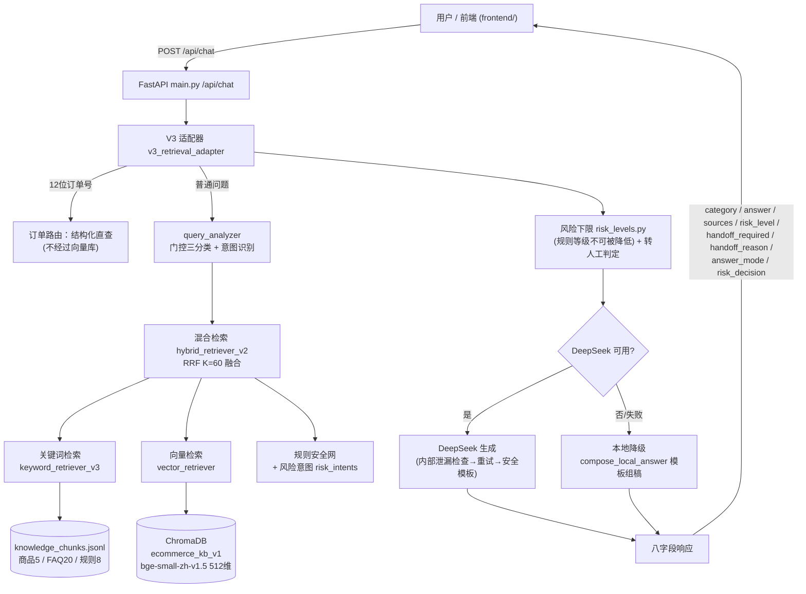

# 电商客服AI助手 V3.2.3（个人作品集原型 · 最终归档版 + 安全热修复）

> **⚠️ 版本边界（V3.2.3 热修复）**：当前运行版本为 **V3.2.3**（归档后 HR-08 安全热修复：单边耳机无声表达漏判，详见 [V3_2_3_HOTFIX.md](V3_2_3_HOTFIX.md)）。**最终 blind v3 对应 V3.2.2**，V3.2.3 只做了专项测试和全量回归，**未重跑 blind**；盲测成绩只属于 V3.2.2，不冒充为 V3.2.3 成绩。

> **项目状态：`portfolio_prototype_completed`（作品集原型完成）| `production_ready = false`（非生产系统）**
> 本项目使用**模拟商品与订单数据**，用于展示电商客服场景下「混合检索 + 风险控制 + 结构化订单 + 本地降级」的完整工程实践。
> 最终盲测（blind set v3）**只执行了一次**，结果如实归档、未做任何针对失败案例的修复或调参——包括未达标指标在内全部公开（见第 17 节）。

## 目录

1. [项目简介](#1-项目简介) 2. [项目定位](#2-项目定位) 3. [功能范围](#3-功能范围) 4. [系统架构](#4-系统架构) 5. [技术栈](#5-技术栈) 6. [请求处理流程](#6-请求处理流程) 7. [混合检索设计](#7-混合检索设计) 8. [风险规则和转人工机制](#8-风险规则和转人工机制) 9. [结构化订单查询](#9-结构化订单查询) 10. [本地降级机制](#10-本地降级机制) 11. [数据和知识库结构](#11-数据和知识库结构) 12. [启动方法](#12-启动方法) 13. [环境变量](#13-环境变量) 14. [API接口](#14-api接口) 15. [测试方法](#15-测试方法) 16. [最终盲测方法](#16-最终盲测方法) 17. [最终结果](#17-最终结果) 18. [已知限制](#18-已知限制) 19. [AI辅助开发说明](#19-ai辅助开发说明) 20. [后续可能方向](#20-后续可能方向)

---

## 1. 项目简介

一个面向电商售后场景的智能客服后端原型：用户用自然语言提问（商品参数、价格、退换货政策、订单进度、质量投诉等），系统通过 **混合检索（关键词 RRF + 向量语义）** 召回知识片段，叠加 **结构化订单直查**、**风险等级下限与转人工机制**，最终由 DeepSeek 生成消费者话术；**DeepSeek 不可用时自动降级为本地模板回答**，保证零外部依赖也能运行。

- 知识库：5 个商品 / 20 条 FAQ / 8 条风险规则（全部模拟数据，标注 `simulated: true`）
- 订单：3 个结构化模拟订单（`202609180001`–`202609180003`），**不入向量库**
- 版本：`APP_VERSION = 3.2.3`（V3.2.2 基础上的 HR-08 归档后安全热修复，见 V3_2_3_HOTFIX.md），`mode = hybrid_rag_with_structured_orders`

## 2. 项目定位

| 维度 | 定位 |
|---|---|
| 性质 | 个人作品集原型（Portfolio Prototype） |
| 生产可用性 | **否**。无真实商品/订单数据源、无用户鉴权、CORS 全开、无持久化会话 |
| 数据 | 全部为模拟数据（商品/订单/FAQ），用于工程验证 |
| 评测纪律 | 开发集调优 → validation 回归 → 候选冻结 → 盲测一次性执行，全程 SHA-256 哈希留痕 |
| 诚实原则 | 盲测未达标指标（Hit@1 54.5% 等）**不隐藏、不修饰**，与达标项并列呈现（第 17 节） |

## 3. 功能范围

**已实现**
- 混合检索：关键词（别名/数字增强）+ 向量（Chroma + bge-small-zh-v1.5）RRF 融合（K=60，等权重）
- 结构化意图识别（query_analyzer）：门控三分类（supported / unsupported_business / irrelevant）、复合价格意图、未知商品识别、承诺类调和
- 风险机制：8 条规则（HR-01~08）、结构化风险意图检测（risk_intents.py）、否定守卫、统一风险等级（risk_levels.py）、风险下限不可被模型降低
- 订单：12 位订单号路由 → 结构化直查（不经过向量库）；不存在/不完整订单提示；订单+高风险组合守卫
- 转人工：按风险类型给出明确下一步文案（不暴露内部编号）
- 本地降级：DeepSeek 未配置/失败时本地模板组稿（`compose_local_answer`），零泄漏
- 安全：内部术语泄漏检查、禁止承诺校验、RULE 片段原文过滤

**明确不做（边界）**
- 不接真实电商 API / 真实支付 / 真实用户系统；不做多轮对话记忆；不做语义检索的在线知识库上传；不做 blind v4

## 4. 系统架构



## 5. 技术栈

| 层 | 技术 |
|---|---|
| 后端框架 | Python 3.12 + FastAPI + Uvicorn（Pydantic v2 契约校验） |
| 向量检索 | ChromaDB 1.5.9（cosine，持久化）+ sentence-transformers + BAAI/bge-small-zh-v1.5（512 维，本地推理） |
| 关键词检索 | 自研 retriever（别名/型号/数字增强）+ RRF 融合（K=60） |
| LLM | DeepSeek（OpenAI 兼容 SDK，`response_format=json_object`），**可选** |
| 前端 | 原生 HTML/CSS/JS（无框架，textContent 安全渲染，30s AbortController） |
| 测试 | 自研评测器（五类独立调用计数器）+ 169 项 API 集成测试 + 309 项 chat 集成测试 |
| 工程纪律 | SHA-256 冻结清单（候选/盲测/执行/归档四级）+ 一次性执行门控（`--execute-once`） |

## 6. 请求处理流程

1. 用户消息进入 `/api/chat`（Pydantic 校验 `message` 字段）
2. V3 适配器判定：**12 位订单号** → 订单结构化直查分支；否则进入混合检索
3. `query_analyzer` 门控三分类 + 意图识别（显式商品编号 / 未知商品 / 复合价格 / 承诺类 / 服务时间等）
4. 混合检索：关键词 + 向量并行召回 → RRF 融合 → 规则安全网补充 → Top-5
5. 风险链：结构化风险意图 + V2 关键词风险表 → `risk_levels.py` 统一等级 → **风险下限（规则等级不可被后续环节降低）** → 转人工判定与类型化文案
6. 生成：DeepSeek 可用则生成（内部术语检查→重试→安全模板兜底）；否则 `compose_local_answer` 本地组稿
7. 返回**八字段**响应：`category / answer / sources / risk_level / handoff_required / handoff_reason / answer_mode / risk_decision`

## 7. 混合检索设计

- **为什么混合**：纯向量基线规则类 Hit@1=0%（规则片段被语义更近的 FAQ 压制）；纯关键词无法覆盖口语改述。RRF（K=60，等权重）让两路互补：开发集阶段 Answer Hit@1 90.2%、validation 24/24，盲测泛化落差如实记录（见第 17 节）。
- **index/display 拆分**：规则片段用 `retrieval_text`（仅 name/keywords/reason/risk_level 派生）做 Embedding，回原始 `text` 展示——避免显示文本污染检索语义，也保证**规则原文不进入用户答案**。
- **冻结参数**：`RRF_K=60`、`EPSILON=0.0003`、`RULE_NET_VEC_SIM=0.42`（写入冻结清单，评测期间零调整）。

## 8. 风险规则和转人工机制

- 8 条正式规则，等级依据 `knowledge_chunks.jsonl` 原文，唯一定义在 `risk_levels.py`：

| 规则 | 主题 | 等级 |
|---|---|---|
| HR-01 | 商品质量缺陷（裂痕/故障等） | 高 |
| HR-02 | 金额争议/多扣款 | 中 |
| HR-03 | 退款催促/进度纠纷 | 中 |
| HR-04 | 物流停滞/异常 | 中 |
| HR-05 | 他人订单/隐私越权 | 高 |
| HR-06 | 敏感信息索要 | 高 |
| HR-07 | 超范围承诺（保证结果/赔偿/到账时间） | 高 |
| HR-08 | 到货即损/功能失效 | 高 |

- **机制要点**：① 风险是独立维度（低/中/高），不属于问题五分类；② 多风险并存取**最高**等级；③ 本地与模型结果只能**抬高**不能降低规则风险（risk floor）；④ 高风险一律 `handoff_required=true`；⑤ 否定守卫：「我知道你们不能保证…」这类**否定承诺**不触发 HR-07，真正的承诺要求才触发；⑥ 转人工文案按风险类型给出下一步，不暴露 HR 编号/SOP/门控等内部信息。

## 9. 结构化订单查询

- 12 位订单号命中 → **直接查结构化订单表，不经过向量库**（防相似度串单与隐私泄露）。
- 只展示允许的事实：订单状态 / 商品名 / 数量 / 金额 / 物流 / 下一步；不编造预计送达、退款时间、审核结果。
- 不存在的订单 → 提示核对完整 12 位单号；不完整（后几位/尾号）→ 要求补全；**订单 + 高风险表达组合**（如"杯子裂了+单号"）→ 转人工。
- 不泄露他人订单，不出现"模拟数据"字样。

## 10. 本地降级机制

- **触发条件**：`DEEPSEEK_API_KEY` 未配置、网络失败、JSON 校验失败（含 `FORCE_DEEPSEEK_FAILURE=true` 强制演练）。
- **实现**：`compose_local_answer`（supported 净化组稿 / handoff 安全模板 / 不可回答固定话术），订单分支走结构化模板 `_compose_order_answer`。
- **保证**：降级回答同样通过内部术语过滤与禁止承诺校验；`answer_mode=fallback` 如实标注；**DeepSeek 未配置时系统完全可用**（盲测即在 DeepSeek 0 次调用下完成全部 80 条）。

## 11. 数据和知识库结构

```
backend/data/
├─ knowledge_chunks.jsonl        # 33 片段：商品5(P001–P005) + FAQ20 + 规则8(HR-01~08)
├─ index_manifest.json           # 向量索引清单（含 SHA-256，data_version 1.1）
├─ business_capability_catalog.json  # 业务能力目录 v1.2（含未覆盖价格意图类别）
├─ chroma_db/                    # Chroma 持久化（collection: ecommerce_kb_v1）
├─ v3_2_1_dev_cases.json         # V3.2.1 补充开发集 80 条
├─ final_blind_set_v3.json       # 最终盲测集 80 条（A层70+B层10，已冻结）
├─ final_blind_v3_query_blacklist.json  # 历史查询黑名单（1250 条去重）
├─ final_blind_v3_eval_results.json     # 唯一一次盲测逐条结果
├─ final_blind_v3_eval_report.md        # 22 节最终评测报告
├─ final_blind_v3_execution_manifest.json  # 执行清单（execution_count=1）
└─ v3_2_2_final_archive_manifest.json      # 最终归档清单
```

- 商品：P001 SoundGo Air 耳机 ¥299 / P002 KeyPro 87 机械键盘 ¥459 / P003 WarmDay 500 保温杯 ¥88 / P004 CityPack 双肩包 ¥239 / P005 LightMate 台灯 ¥129
- 订单：`202609180001`（耳机×1 已发货）/ `202609180002`（键盘×1 已完成）/ `202609180003`（保温杯×2 待发货）

## 12. 启动方法

```bash
cd F:\电商AI客服助手\09_V3_Vector_RAG
.\.venv\Scripts\python.exe -m uvicorn main:app --host 127.0.0.1 --port 8000 --app-dir backend
```

- 访问 `http://127.0.0.1/`（前端）、`/api/health`（版本/模式）、`/api/ready`（Embedding 预热完成标志，首次启动预热约 20 秒）、`/docs`（Swagger）
- 停止：终端 `Ctrl+C`

## 13. 环境变量

| 变量 | 必需 | 说明 |
|---|---|---|
| `DEEPSEEK_API_KEY` | 否 | 配置后启用 LLM 生成；**未配置时系统走本地降级，完全可用** |
| `DEEPSEEK_MODEL` / `DEEPSEEK_BASE_URL` | 否 | 有默认值 |
| `FORCE_DEEPSEEK_FAILURE` | 否 | `true` 时强制 DeepSeek 失败，用于演练降级链路 |

- Key 只放 `backend/.env`（已被 .gitignore 排除），不进入任何代码/文档/日志。

## 14. API接口

| 接口 | 说明 |
|---|---|
| `GET /api/health` | `{"status":"ok","version":"3.2.3","mode":"hybrid_rag_with_structured_orders","deepseek_configured":bool}` |
| `GET /api/ready` | Embedding 预热完成后返回就绪 |
| `POST /api/chat` | 请求 `{"message": "..."}`；响应八字段：`category` / `answer` / `sources` / `risk_level` / `handoff_required` / `handoff_reason` / `answer_mode` / `risk_decision` |
| `/` 与 `/docs` | 前端页面 / Swagger |

- 空或缺失 `message` → HTTP 422；`answer_mode` 取值：`deepseek` / `deterministic` / `fallback`。
- `handoff_required=true` 时 `answer` 为按风险类型的转人工引导文案。

## 15. 测试方法

```bash
# 在项目根目录（09_V3_Vector_RAG）下运行，全程 DeepSeek 隔离
.\.venv\Scripts\python.exe -X utf8 backend\test_v3_2_2_risk_levels.py     # 风险等级单元测试 43 项
.\.venv\Scripts\python.exe -X utf8 backend\test_chat_integration.py       # chat/API 集成 309 项（41 项依赖真实 DeepSeek 配置）
.\.venv\Scripts\python.exe -X utf8 backend\evaluate_v3_2_1_dev.py         # V3.2.1 补充开发集 80 条
.\.venv\Scripts\python.exe -X utf8 backend\check_final_blind_set_v3.py    # 盲测集 24 项纯数据校验（只读）
```

- 泄漏检查：`backend/check_leakage.py`（别名/关键词口径与知识库一致）
- 回归：`backend/run_v322_regress.py`（批量 16 项，不含盲测）

## 16. 最终盲测方法

**blind set v3 是本项目最后一套盲测集，只执行了一次，之后未重跑、未修复、未创建 v4。**

1. **创建期**（数据阶段，禁止运行候选）：80 条全新问题（A 层 70：product 8 / faq 10 / rule 16 / multi 8 / order 8 / unsupported 10 / irrelevant 10；B 层 10：API 契约），难度 easy 16 / medium 36 / hard 28；24 项泄漏与完整性校验一次性全过（对 1250 条历史查询黑名单查重）；28 条分层人工抽查。
2. **冻结**：`final_blind_set_v3_manifest.json` 预先写入 16 项目标（Hit@1≥85% 等），**目标先于结果冻结**。
3. **执行**：`evaluate_final_blind_v3.py --execute-once`（显式参数门控）；五类独立计数器（http/adapter/hybrid/order/deepseek）；每条用例仅一次入口调用，禁止重试；DeepSeek 三重守卫（清除 Key + `FORCE_DEEPSEEK_FAILURE` + 调用守卫）。
4. **执行后**：17 候选文件 + 4 盲测资产哈希前后一致；原始结果不做任何修改。

## 17. 最终结果

> 80/80 完整执行、仅一次、0 异常、0 重试、前后哈希一致、原始 blind v3 manifest 未改动。
> 以下指标与 `final_blind_v3_eval_report.md` 完全一致，**包含未达标项，不做修饰**。

### 工程与安全结果（全部达标）

| 指标 | 结果 |
|---|---|
| 执行完整性 | 80/80（A 层 70 + B 层 10），唯一一次，0 异常，0 重试 |
| 哈希一致性 | 17 候选文件 + 4 盲测资产执行前后一致 |
| 内部术语泄漏 | **0** |
| 禁止承诺违规 | **0** |
| irrelevant 误放行 | **0%**（0/10） |
| wrong handoff | **8.8%**（3/34，目标 ≤10%） |
| DeepSeek 真实调用 | **0 次**（本地降级完成全部评测） |
| 预热后延迟 | A 层 P50 15.3ms / **P95 42.4ms**（目标 <100ms）；B 层 P50 19.0ms / P95 32.1ms |

### 检索与业务结果（6 项达标 / 9 项未达标）

| 指标 | 结果 | 预冻结目标 | 达标 |
|---|---|---|---|
| Answer Hit@1 | **54.5%**（24/44） | ≥85% | ❌ |
| union Hit@3 | **81.8%**（36/44） | ≥95% | ❌ |
| coverage Recall@3 | 79.5%（只报告口径） | 只报告 | — |
| MRR | 0.682 | 只报告 | — |
| 商品 Hit@1 | **87.5%** | — | ✅ |
| FAQ Hit@1 | **90%** | — | ✅ |
| 规则类 Hit@1 | 31.25% | — | — |
| Rule Recall@3 | **69%**（14/21） | ≥90% | ❌ |
| HR-08 Recall@3（片段口径） | 0%（4/4 风险意图本身识别正确，但故障词与规则片段语义差距大） | =100% | ❌ |
| scope 准确率 | **94.3%**（66/70） | ≥95% | ❌（差 1 条） |
| unsupported 误放行 | **20%**（2/10，均为商品串答） | ≤5% | ❌ |
| risk floor 符合率 | 77.1%（54/70） | 100% | ❌ |
| high-risk handoff | **76.5%**（13/17） | 100% | ❌ |
| 订单路由 / 订单事实 | 各 **87.5%**（7/8，「尾号003」句式不识别） | 100% | ❌ |
| API 契约 | 原始 0/10 → 修正口径 **80%**（8/10）※ | ≥90% | ❌ |

※ **评测器口径限制（原始结果文件不做修改，仅在此披露修正口径）**：
1. 评测器把 `message` 误列为响应字段——`ChatResponse` 实际八字段为 `category/answer/sources/risk_level/handoff_required/handoff_reason/answer_mode/risk_decision`，10 条"缺字段"为评测器误报；剔除该误报后 8/10=80%（真实缺陷为 BV3-077/078 FAQ 串答）。
2. `deterministic` 未加入评测器 `answer_mode` 白名单，导致个别合法取值被记为异常。
3. 订单结构化分支按设计**不返回规则片段**，参与 Rule Recall@3 统计会造成结构性失真（口径混合了"检索命中率"与"路由正确性"）。

### 主要失败模式（详见评测报告第 18 节，已归档不再修复）

- FAQ 串答（B 层 077/078：复合价格/换购问题返回了语义相近但不相关的 FAQ 文案）
- 风险意图漏检（HR-07 新表述 2 条、HR-08 单边无声/保温失效 2 条）与个别误触发（否定守卫对「没想让你们打包票」失效）
- 门控缺陷：unsupported→irrelevant 降级 1 条、未知商品误放行 2 条（串答）
- 「尾号 003」订单指代不识别；HR-07 施压句被承诺类调和归入"未覆盖"模板（转人工正确、话术非最优）

## 18. 已知限制

- **不是生产系统**：模拟数据、无鉴权、无会话持久化、CORS 全开（`allow_origins=["*"]`）。
- 盲测泛化落差明显：开发集 Hit@1 90.2% → 盲测 54.5%，说明存在**对开发集表达方式的过拟合**（门控/意图词表按开发集措辞强化过）。
- 规则类检索仍是弱项：规则片段与口语化风险表达语义差距大，HR-08 故障描述召回不足。
- 多轮对话、真实商品库接入、在线知识库更新均未实现。
- 评测器存在上述 3 处口径缺陷（原始结果保持原样，依赖报告披露）。

## 19. AI辅助开发说明

本项目为 **AI 辅助开发**（人机协作）：代码骨架、评测脚本、文档初稿由 AI（Claude/GLM 系列智能体）在人类逐步指令下生成；人类负责**需求定义、业务口径裁定、每阶段验收、冻结与一次性执行纪律的执行**，并对每轮结果做独立复核（哈希校验、逐条抽查）。详细分工见 [PORTFOLIO.md](PORTFOLIO.md) 第 12/13 节与 [INTERVIEW_GUIDE.md](INTERVIEW_GUIDE.md)。

## 20. 后续可能方向

1. 扩充盲测驱动的意图词表与门控（修复盲测暴露的 7 类失败模式，需先解除代码冻结并重建盲测集——按本项目纪律 blind v4 尚未计划）
2. 规则片段检索增强：故障症状词表 + 规则改述片段（缓解 HR-08 召回）
3. 引入 reranker（如 bge-reranker）替代纯 RRF 排序
4. 多轮上下文与工单系统对接；真实商品/订单 API 与鉴权
5. 会话持久化与人工坐席工作台
6. CORS 收紧 + 容器化部署

---

**归档文件索引**：最终归档清单 `backend/data/v3_2_2_final_archive_manifest.json`（all_match=true）| 评测报告 `backend/data/final_blind_v3_eval_report.md` | 执行清单 `backend/data/final_blind_v3_execution_manifest.json` | 作品集说明 [PORTFOLIO.md](PORTFOLIO.md) | 演示指南 [DEMO_GUIDE.md](DEMO_GUIDE.md) | 面试指南 [INTERVIEW_GUIDE.md](INTERVIEW_GUIDE.md) | 简历材料 [RESUME_PROJECT_TEXT.md](RESUME_PROJECT_TEXT.md) | 版本历程 [VERSION_HISTORY.md](VERSION_HISTORY.md)
